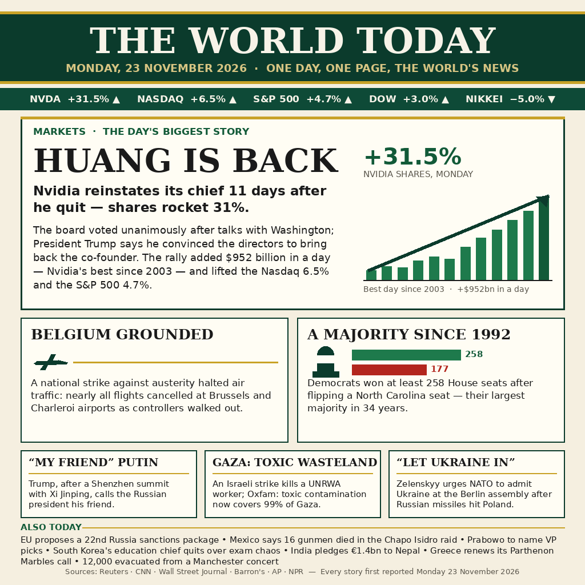

[](https://make.fun/bounty/news-image-20261123)
[](https://make.fun/bounty/news-image-20261123)
[](https://make.fun/bounty/news-image-20261123)

# World News — Monday 23 November 2026

A one-image summary of the world news of 23 November 2026, built for the
[make.fun bounty](https://make.fun/bounty/news-image-20261123)
"Sum up 23 November's world news in one image" ($100, top 50 paid).



## The front page

An emerald-green financial broadsheet on warm newsprint (1024×1024 PNG)
— a different look from the navy 19 Nov, crimson 20 Nov, teal 21 Nov and
charcoal-and-gold 22 Nov editions — with a market ticker tape under the
masthead and a clear visual hierarchy, so the news explains itself with
no feed attached:

- **Hero — HUANG IS BACK.** Nvidia reinstates Jensen Huang as CEO,
  11 days after he resigned; shares rocket 31.5%, adding $952 billion
  in a day — the stock's best day since 2003 — and lift the Nasdaq
  6.5% and the S&P 500 4.7%. Illustrated with a rising-share chart.
- **Belgium grounded.** A national strike against austerity halts air
  traffic: nearly all flights cancelled at Brussels and Charleroi
  airports as controllers walk out.
- **A majority since 1992.** Democrats win at least 258 House seats
  after flipping a North Carolina seat — their largest majority in
  34 years.
- **"My friend" Putin.** Trump, after a Shenzhen summit with Xi
  Jinping, calls the Russian president his friend.
- **Gaza: a toxic wasteland.** An Israeli strike kills a UNRWA worker;
  Oxfam says toxic contamination now covers 99% of Gaza.
- **"Let Ukraine in."** Zelenskyy urges NATO to admit Ukraine at the
  Berlin assembly, after Russian missiles hit Poland.
- **Also today:** the EU proposes a 22nd Russia sanctions package;
  Mexico says 16 gunmen died in the Chapo Isidro raid; Prabowo to
  name VP picks; South Korea's education chief quits over exam chaos;
  India pledges €1.4bn to Nepal; Greece renews its Parthenon Marbles
  call; 12,000 evacuated from a Manchester concert.

Sources: Reuters, CNN, Wall Street Journal, Barron's, AP, NPR. Every
story was date-checked as first reported on 23 November 2026.

## How it works

`main.py` (Python 3.13, standard library only, no network) validates the
bundled `front-page.png` — PNG signature, exactly 1024×1024, at most
1 MiB — and writes it byte-for-byte to `/output/entry.png`, then reads
the output back and verifies its SHA-256 matches the source. Running it
twice produces identical bytes.

```bash
python3 main.py           # writes /output/entry.png
python3 main.py --check   # validate only, write nothing
```

The image itself was drawn with Pillow (build-time only); the entry
program needs no third-party packages.

## License

MIT — see [LICENSE](LICENSE).
